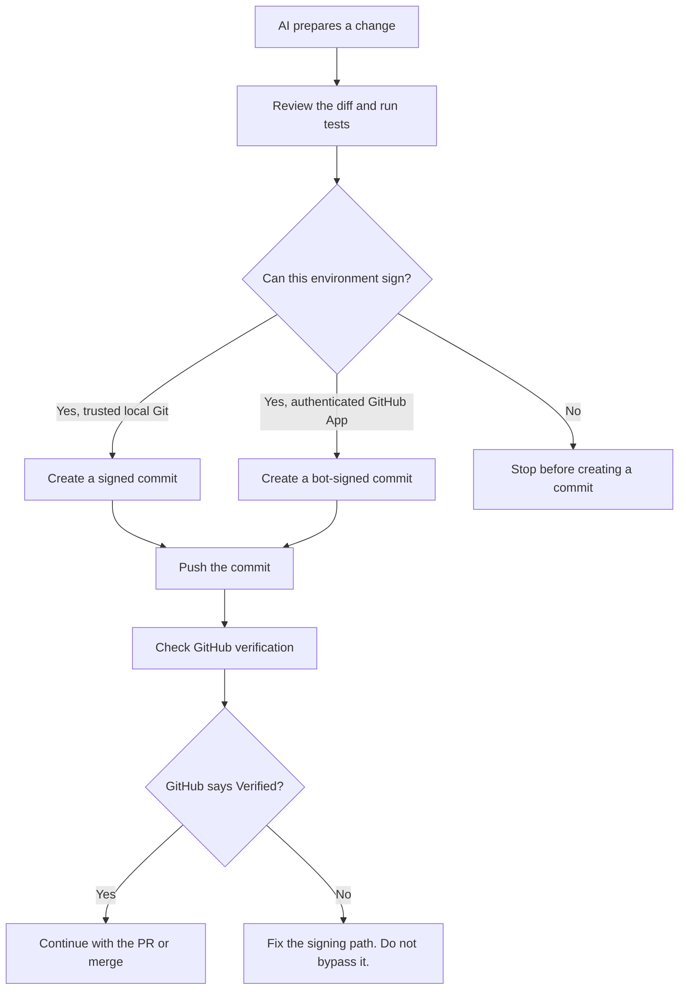

 <a id="top"></a>

<div align="center">

# ✨ Verified by Default

### Make every AI-assisted commit show up as `Verified` on GitHub.

<p>
  
  
  
  
  
  
  
</p>

<p>
  
  
  
  
  
  
  
</p>

<p>
  <a href="https://github.com/RufusTheDwarf/verified-by-default/stargazers">
    
  </a>
  <a href="https://github.com/RufusTheDwarf/verified-by-default/network/members">
    
  </a>
  <a href="https://github.com/RufusTheDwarf/verified-by-default/issues">
    
  </a>
  <a href="https://github.com/RufusTheDwarf/verified-by-default/blob/main/LICENSE">
    
  </a>
  
  
</p>

<p><sub>AI writes the change. A trusted identity signs it. GitHub verifies it.</sub></p>

</div>

---

## The rule

**No unsigned fallback. No pretend verification. No commit reported as Verified until GitHub confirms it.**

This project captures a reliable workflow for working with AI coding assistants while keeping commit signatures valid.

It is not a key generation tutorial. It assumes your Git signing identity is already configured and trusted by GitHub.

## The workflow we want every time



### 1. For an AI assistant working on your machine

The assistant should use the Git installation that already has your signing setup. It must explicitly sign the commit, then verify the result.

```bash
git status --short
git diff --check
git diff

# Run the project's tests before committing.
# Stage only the files that have been reviewed.
git add path/to/reviewed-file

git diff --cached --check
git diff --cached
git commit -S -m "fix: describe the change"
git verify-commit HEAD
git log -1 --show-signature
git push
```

For SSH signatures, local verification may also require an `allowedSignersFile`. The final authority for the GitHub badge is GitHub's own verification result.

### 2. For an AI agent running remotely

A cloud container normally does not have your personal signing key or local signing agent.

**Never upload your private key, passphrase, or agent socket just to get a green badge.**

Use one of these two valid paths:

1. Let the agent prepare the changes and tests, then create the personal signed commit from your trusted local environment.
2. Use a properly authenticated GitHub App or bot that creates commits under its own verified bot identity. GitHub only verifies bot signatures when the request is authenticated as that App or bot and does not override the author, committer, or signature fields.

A bot's `Verified` signature belongs to that bot. It must never be presented as your personal signature.

### 3. Check the actual GitHub result

After pushing, inspect the commit on GitHub. You can also query the commit verification object with GitHub CLI:

```bash
gh api "repos/OWNER/REPOSITORY/commits/$(git rev-parse HEAD)" \
  --jq '.commit.verification | {verified, reason}'
```

The result must report `verified: true`.

A successful `git commit`, a successful push, or a local verification result alone is not proof that GitHub displays **Verified**.

## Make unsigned commits impossible to merge

For the default branch, enable **Require signed commits** in your repository's branch protection rule or ruleset.

This is the enforcement layer. GitHub will reject commits that are not signed and verified on the protected branch. Make sure every commit in a pull request is signed too. An unsigned commit in the pull request can block the merge even when GitHub would sign the final squash commit.

See GitHub's documentation for [protected branches](https://docs.github.com/en/repositories/configuring-branches-and-merges-in-your-repository/managing-protected-branches/about-protected-branches) and [commit signature verification](https://docs.github.com/en/authentication/managing-commit-signature-verification/about-commit-signature-verification).

## Give your AI assistant these rules

Copy [`AGENTS.md`](AGENTS.md) into the root of the repository where your AI assistant works.

It tells the assistant to:

- use the signing configuration that is already trusted;
- review changes and tests before committing;
- explicitly sign every commit;
- stop when signing is unavailable or fails;
- never expose private signing material;
- verify the signature locally and confirm the GitHub status before claiming success.

These instructions guide the assistant. They do not create signing capability or replace GitHub branch protection.

## What counts as Verified?

| Situation | Correct interpretation |
|---|---|
| Local Git commit signed with a GitHub-trusted key | Can display **Verified** after GitHub validates it |
| Commit created by a correctly authenticated GitHub App | Can display **Verified** under the App or bot identity |
| Commit created through GitHub's web interface | Signed by GitHub, not by your personal local key |
| `Signed-off-by` trailer | Sign-off metadata, not a cryptographic signature |
| Author name or email edited to look trusted | Does not create a valid signature |
| Unsigned commit followed by a green CI run | Still unsigned |

## Project files

| File | Purpose |
|---|---|
| [`AGENTS.md`](AGENTS.md) | Mandatory operating rules for AI coding assistants |
| [`docs/01-how-it-works.md`](docs/01-how-it-works.md) | Signing identities, local agents, cloud agents, and bot signatures |
| [`docs/04-ai-workflows.md`](docs/04-ai-workflows.md) | Practical workflow and reusable assistant prompt |
| [`docs/05-verification.md`](docs/05-verification.md) | Local checks and GitHub verification |
| [`docs/06-troubleshooting.md`](docs/06-troubleshooting.md) | Recovery steps when a commit is not verified |
| [`scripts/check-signing.sh`](scripts/check-signing.sh) | Local signature diagnostic |
| [`SECURITY.md`](SECURITY.md) | Secret handling and responsible reporting |
| [`CONTRIBUTING.md`](CONTRIBUTING.md) | Contribution expectations |

## Official references

- [About commit signature verification](https://docs.github.com/en/authentication/managing-commit-signature-verification/about-commit-signature-verification)
- [Signing commits](https://docs.github.com/en/authentication/managing-commit-signature-verification/signing-commits)
- [Protected branches and required signed commits](https://docs.github.com/en/repositories/configuring-branches-and-merges-in-your-repository/managing-protected-branches)

---

<div align="center">

## 💜 Thank you for being here

If this project helped you keep your AI-assisted Git history secure, consider giving it a ⭐ on GitHub.

<p>
  <a href="https://github.com/RufusTheDwarf/verified-by-default">
    
  </a>
</p>

### Created with care by

# [Rufus](https://github.com/RufusTheDwarf)

**[@RufusTheDwarf](https://github.com/RufusTheDwarf)**

<p>
  <a href="https://github.com/RufusTheDwarf">
    
  </a>
  
  
</p>

### Special thanks

To the developers and maintainers behind **Git**, **GitHub**, **OpenSSH**, and **GnuPG**, whose work makes secure commit signing possible.

Thanks also to everyone building AI coding tools, contributing ideas, reporting issues, improving documentation, and helping make secure development the default.

**And most importantly, thanks to you for caring about trustworthy commits.**

---

<p>
  <a href="#top">⬆ Back to top</a>
  &nbsp; · &nbsp;
  <a href="LICENSE">MIT License</a>
  &nbsp; · &nbsp;
  <a href="SECURITY.md">Security</a>
  &nbsp; · &nbsp;
  <a href="CONTRIBUTING.md">Contributing</a>
  &nbsp; · &nbsp;
  <a href="https://github.com/RufusTheDwarf">My GitHub</a>
</p>

<sub>Review every change. Sign every commit. Verify every push.</sub>

<sub>© RufusTheDwarf. Released under the MIT License.</sub>

</div>
